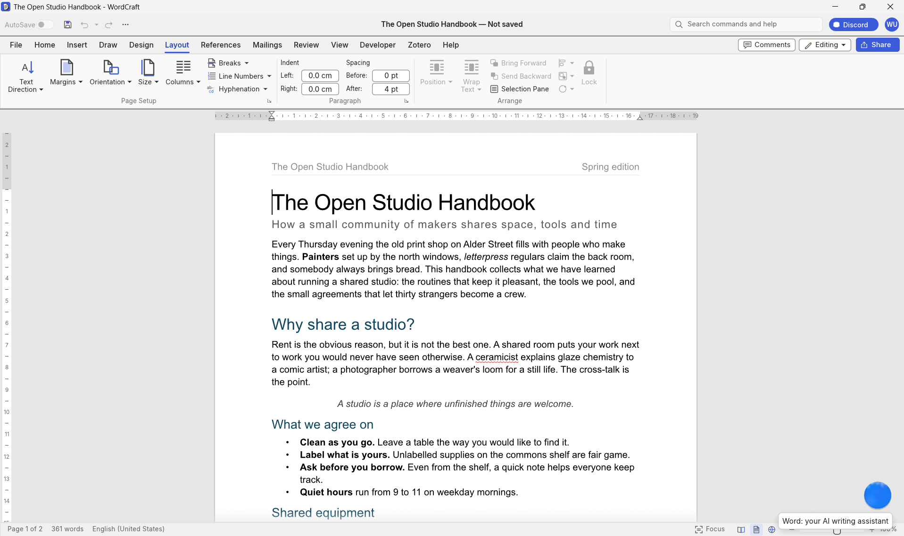
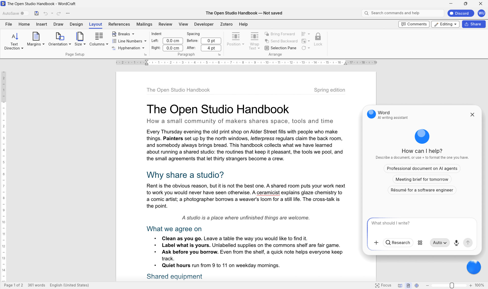
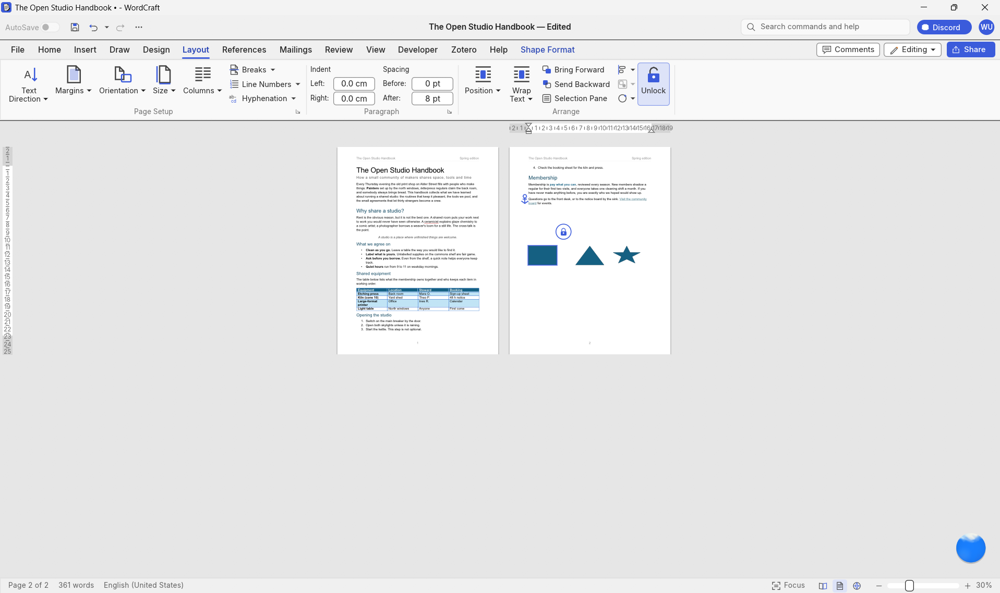
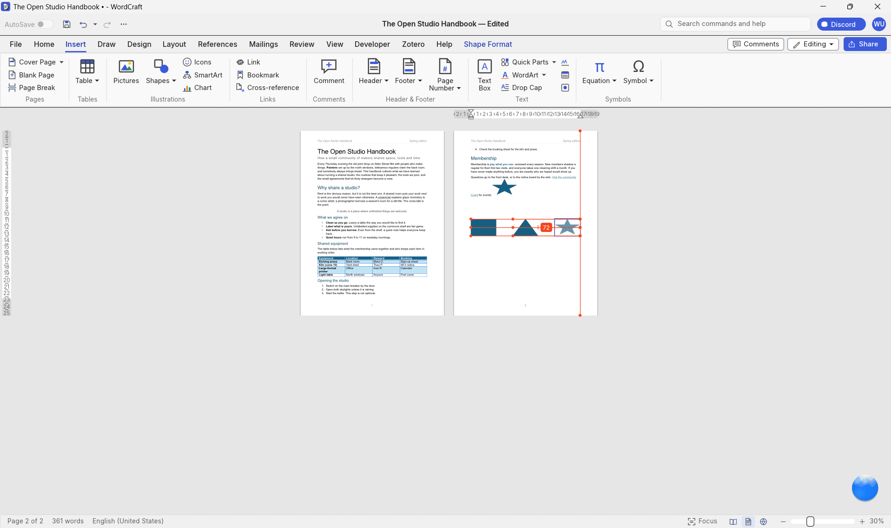
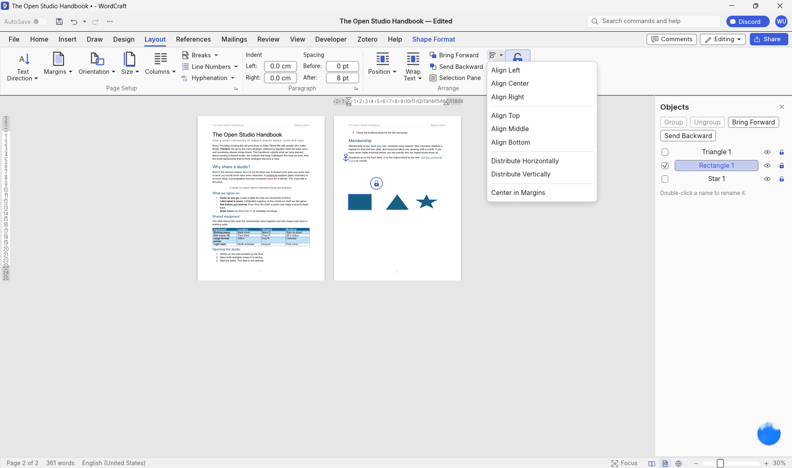

<div align="center">

# WordCraft — Extended Edition

### Document editing, precise object controls, and AI-assisted document workflows.

An independently modified version of [WordCraft](https://github.com/storytold/wordcraft), extending the original Rust word processor with object management, reusable components, protected templates, visual review, and AI-assisted research and editing.

**Extensions by Sai Krishna Siddu and Karthikplays(Github: https://github.com/Karthikplays)**  
**Original WordCraft by the ArtCraft Team and WordCraft contributors**

[Features](#features-added-in-this-version) ·
[Screenshots](#screenshots) ·
[Getting Started](#getting-started) ·
[Architecture](#architecture) ·
[Credits](#credits-and-acknowledgments)

</div>

---



## About

This project builds on WordCraft’s existing document editor and command-based architecture.

The additions focus on two areas:

- **Document control:** manage objects, protect important content, reuse document components, and review layout changes.
- **AI-assisted workflows:** create documents from instructions, research sources, apply formatting requirements, preview proposed edits, and validate changes before committing them.

The goal is to make complex document work easier while preserving the familiar editing workflow.

This repository is an independent extension of the upstream project. The original editor, rendering system, file-format support, and much of the interface were developed by the WordCraft team.

## Features Added in This Version

### Document Editing and Object Management

| Feature | What it adds |
| --- | --- |
| Object and table locking | Protect supported objects and tables against accidental changes, with quick lock and unlock controls. |
| Document Objects panel | Find and manage objects from a dedicated panel, including objects that overlap or are difficult to select on the page. |
| Smart alignment and spacing | Position objects using alignment controls, snapping, guides, and even distribution. |
| Hide and show objects | Temporarily hide supported objects without deleting them, then restore them from the Objects panel. |
| Reusable document components | Save and reuse common document elements, with linked-instance support for coordinated updates. |
| Protected templates and editable regions | Keep fixed template content protected while allowing designated fields or regions to be edited. |
| Improved object layout controls | Manage object positioning, text wrapping, anchoring, and stacking order more clearly. |
| Visual document review | Compare document versions and review content, layout, and object changes before finalizing. |

### 1. Object and Table Locking

Protect important document elements while continuing to work around them.

- Lock and unlock supported images, shapes, text boxes, groups, and tables.
- Prevent accidental movement, resizing, deletion, and protected-content changes.
- Use a quick lock control beside the rotation handle for supported drawing objects.
- Keep the existing rotation control available separately.
- Access locking through the ribbon.
- Toggle locking with **Ctrl + Alt + L**.
- Preserve lock information when saving and reopening supported DOCX documents in this version.
- Apply protection through the document engine so command-based edits respect locks.

**Ctrl + L remains assigned to paragraph alignment.**

Locks help prevent accidental edits; they are not encryption or password-based access control. WordCraft-specific lock metadata may not be enforced or preserved by other editors.

### 2. Document Objects Panel

Manage document objects without repeatedly searching through pages.

- List supported images, shapes, text boxes, and groups.
- Select and navigate to objects from the panel.
- Rename objects for easier identification.
- Lock, unlock, hide, and restore objects.
- Reorder objects and manage related groups.
- Reach overlapping objects that are difficult to select directly.

### 3. Smart Alignment and Spacing

Arrange diagrams, labels, images, and other supported objects more precisely.

- Align objects horizontally and vertically.
- Distribute multiple objects evenly.
- Use smart guides and snapping during positioning.
- Review positioning and spacing guides while arranging elements.

### 4. Hide and Show Objects

Temporarily simplify a document without removing its content.

- Hide supported objects.
- Restore hidden objects through the Objects panel.
- Manage visibility separately from locking and deletion.

### 5. Reusable Document Components

Reuse common document elements across projects.

- Save headers, footers, callouts, signature blocks, and branded sections.
- Insert saved components into other documents.
- Use linked instances where coordinated updates are needed.
- Update linked instances when their source component changes.

### 6. Protected Templates and Editable Regions

Create templates with a clear separation between fixed content and user input.

- Protect institutional headers, logos, disclaimers, and standard sections.
- Leave designated fields or regions editable.
- Build forms and templates on the existing protection and content-control functionality.

### 7. Improved Object Layout Controls

Make object placement easier to understand and adjust.

- Control floating-object placement.
- Adjust text wrapping and anchoring.
- Manage overlapping elements and stacking order.
- Refine how objects behave when surrounding text changes.

### 8. Visual Document Review

Review changes before finalizing a document.

- Compare document versions visually.
- Identify layout and object-level differences.
- Review comments and proposed changes.
- Extend the existing comparison and commenting workflow.

## AI-Assisted Document Workflows

The AI workflow covers planning, research, formatting, preview, and validation.

| Feature | Purpose |
| --- | --- |
| Natural-language document creation | Turn a plain-language goal into a structured document draft. |
| Research and source verification | Gather sources, connect citations to claims, and flag unsupported statements. |
| Intelligent formatting and typography | Apply suitable typography, heading structure, spacing, and layout. |
| Guidelines and compliance assistance | Interpret formatting requirements and check the document against structured rules. |
| Persistent research context | Maintain research goals, terminology, decisions, and relationships across chapters. |
| Citation and research-integrity assistance | Review citation coverage, references, attribution, and supported similarity checks. |
| Preview before committing | Review and edit proposed changes separately from the original document. |
| Validation and safe commit | Inspect the result, check layout, and commit approved changes with recovery options. |

### 1. Natural-Language Document Creation

Describe the document you need in ordinary language.

The workflow uses the request to determine:

- Document type and purpose.
- Intended audience.
- Structure and required sections.
- Expected depth.
- Output format.

Example:

> Create a professional report on AI agents for a project review, with an introduction, architecture overview, use cases, limitations, and references.

### 2. Research and Source Verification

Support research-based writing with traceable evidence.

- Prioritize official documentation, primary research, and credible publications.
- Associate citations with relevant claims.
- Flag unsupported statements and questionable references.
- Distinguish sourced facts from assumptions and AI-generated suggestions.

Source availability and verification depend on the configured research tools and accessible material.

### 3. Intelligent Formatting and Typography

Apply consistent formatting suited to the document’s purpose.

- Recommend a small set of suitable font choices.
- Establish a clear heading hierarchy.
- Set font sizes, margins, line spacing, and paragraph spacing.
- Identify inconsistent formatting and alignment.
- Improve page breaks and document structure.
- Adapt formatting for academic papers, reports, resumes, and other document types.

### 4. Official Guidelines and Compliance Assistance

Use institutional or publication requirements to guide formatting.

- Work with university, journal, conference, and organizational guidelines.
- Interpret uploaded guideline PDFs.
- Convert requirements into structured rules.
- Check margins, fonts, spacing, citations, page limits, headings, and required sections.
- Flag conflicting or unverified requirements for review.

Compliance checks assist the author; they do not replace the institution’s or publisher’s final assessment.

### 5. Persistent Research Context

Maintain continuity across longer writing projects.

- Retain research questions, objectives, terminology, and methodology.
- Track results and writing decisions.
- Connect related sections and chapters.
- Flag contradictions, repeated explanations, and unsupported conclusions.
- Compare reported results with the conclusions drawn from them.

### 6. Citation and Research-Integrity Assistance

Help authors identify gaps in attribution and supporting evidence.

- Suggest where citations may be needed.
- Review citation placement and bibliography completeness.
- Flag potentially fabricated or unverifiable references.
- Identify possible attribution issues.
- Support similarity checks through available services or source collections.

Similarity checking depends on access to suitable sources or an integrated service. An AI model alone cannot guarantee plagiarism detection or research correctness.

### 7. Preview Before Committing

Review proposed edits before they affect the original document.

- Generate an isolated, editable draft.
- Compare the original and proposed document side by side.
- Highlight content, typography, spacing, and layout changes.
- Accept or reject individual changes, categories, or the full proposal.
- Refine the proposed draft before approval.

### 8. Automatic Validation and Safe Commit

Check the actual document produced by the editing workflow.

- Inspect document structure after editing.
- Render pages and review layout issues.
- Repair supported formatting problems and validate again.
- Commit approved changes through the document engine.
- Preserve undo and rollback options.
- Detect changes to the original document made while a preview was open.

## Typical AI Workflow

1. Describe the document or editing task.
2. Provide relevant sources, guidelines, and existing content.
3. Generate a researched and formatted draft.
4. Review the draft beside the original.
5. Refine, accept, or reject proposed changes.
6. Validate the approved result.
7. Commit changes and save or export the document.

The original remains unchanged until the proposed edits are approved.

## Screenshots

### AI Interface



*AI-assisted document workflow within WordCraft.*

### Object Locking



*Lock and unlock supported objects to protect them against accidental changes.*

### Alignment Tools



*Alignment and spacing controls for arranging document objects.*

### Object Selection



*Object selection within the document editor.*

## Existing WordCraft Foundation

The following capabilities come from the original WordCraft project and form the foundation of this extension.

| Area | Existing capabilities |
| --- | --- |
| Writing | Rich-text editing, selection, clipboard, undo and redo, find and replace. |
| Formatting | Character formatting, paragraph formatting, styles, themes, lists, and numbering. |
| Tables | Table insertion, merging and splitting, borders, shading, styles, sorting, and formulas. |
| Page layout | Margins, orientation, columns, sections, headers, footers, page numbering, and watermarks. |
| Objects | Pictures, shapes, text boxes, resizing, rotation, cropping, and text wrapping. |
| References | Tables of contents, footnotes, endnotes, citations, bibliographies, captions, and cross-references. |
| Review | Comments, tracked changes, document comparison, proofing, and editing restrictions. |
| File support | DOCX read/write, legacy DOC import, PDF export, and additional document formats. |
| Automation | Command registry, command-line tooling, MCP integration, and application control. |
| Platforms | Upstream support for native desktop applications and a WebAssembly browser build. |

Platform support inherited from upstream does not by itself confirm that every extension has been tested on every platform.

## Getting Started

### Requirements

- Rust and Cargo compatible with the repository’s `Cargo.toml`.
- Git, if cloning the repository.
- Native build tools required by your operating system.

AI features additionally require the provider, model, and service configuration supported by this build. External research and similarity services may require network access and separate credentials.

### Clone Your Repository

Replace the placeholders with the address of this modified repository.

```sh
git clone https://github.com/YOUR_GITHUB_USERNAME/YOUR_REPOSITORY_NAME.git
cd YOUR_REPOSITORY_NAME
```

### Run the Desktop Application

```sh
cargo run -p wordcraft -- --sample
```

### Run an Optimized Build

```sh
cargo run --release -p wordcraft -- --sample
```

### Open an Existing Document

```sh
cargo run --release -p wordcraft -- "path/to/document.docx"
```

### Build Without Launching

```sh
cargo build --release -p wordcraft
```

Build this repository to use its added features. Upstream release downloads are separate builds and should not be assumed to include these extensions.

## Architecture

The project extends WordCraft’s existing Rust workspace.

| Location | Responsibility |
| --- | --- |
| `apps/wordcraft` | Native desktop application. |
| `apps/wordcraft-cli` | Command-line document operations. |
| `apps/wordcraft-web` | Browser application. |
| `crates/doc` | Document model and editing primitives. |
| `crates/engine` | Commands, editing sessions, history, and document operations. |
| `crates/ui-egui` | Ribbon, panels, dialogs, and editor interface. |
| `crates/layout` | Text layout, pagination, and object placement. |
| `crates/docx` | DOCX import and export. |
| `crates/formats` | Additional document formats. |
| `crates/render` | Document rendering. |
| `crates/pdf` | PDF export. |
| `crates/mcp` | MCP integration. |

The command-based design provides a shared execution path for interface actions, keyboard shortcuts, and automation.

## Development and Verification

Check the application:

```sh
cargo check -p wordcraft
```

Run the engine and DOCX tests:

```sh
cargo test -p wordcraft-engine
cargo test -p wordcraft-docx
```

Run the repository’s broader checks:

```sh
cargo xtask ci
```

These are verification commands, not a statement that all checks currently pass.

When changing document behavior, verify:

- Existing editing actions still work.
- Locked content rejects prohibited changes.
- Undo and redo behave correctly.
- Save and reopen preserve supported metadata.
- Unlocked content remains editable.
- Preview edits do not modify the original before approval.
- Exported documents retain the expected content and layout.

## Compatibility and Limitations

- DOCX compatibility depends on the features used and the editor opening the file.
- WordCraft-specific metadata may be ignored or removed by other applications.
- Object locking prevents accidental editing; it does not provide cryptographic security.
- AI output and references require author review.
- Research and similarity coverage depend on configured tools and available sources.
- Export formats may not preserve every editing feature or application-specific property.
- This project focuses on document editing. An infinite canvas, animation timelines, website building, and a separate collaborative whiteboard are outside its scope.

## Contributing

Bug reports and focused improvements are welcome.

Before submitting changes:

1. Read [AGENTS.md](AGENTS.md).
2. Describe the problem and expected behavior.
3. Keep changes focused on the relevant feature.
4. Add suitable regression coverage for behavior changes.
5. Run the applicable verification commands.
6. Document new assets in [ATTRIBUTION.md](ATTRIBUTION.md).

For bug reports, include reproduction steps, operating system, relevant logs, and a sample document when possible. Remove private information before sharing files.

## Credits and Acknowledgments

### Original Project

This project is based on **WordCraft**, created by the **ArtCraft Team and WordCraft contributors**.

- [Original repository](https://github.com/storytold/wordcraft)
- [Original project website](https://getartcraft.com/apps/wordcraft)

The original team deserves credit for the editor foundation, Rust architecture, document model, layout and rendering systems, format support, command infrastructure, and existing interface.

### Extensions in This Repository

**Sai Krishna Siddu and Karthik**

The work in this modified version focuses on object management and protection, reusable components, protected templates, layout controls, visual review, and the AI-assisted document workflow described above.

This repository is independently maintained and does not imply endorsement by the original maintainers.

### Third-Party Assets and Dependencies

Third-party libraries and assets retain their respective licenses and attribution requirements.

See:

- [ATTRIBUTION.md](ATTRIBUTION.md)
- [NOTICE](NOTICE)

## License

The upstream WordCraft code is dual-licensed under **MIT OR Apache-2.0**.

- [MIT license](LICENSE-MIT)
- [Apache License 2.0](LICENSE-APACHE)

Original copyright:

> Copyright (c) 2026 ArtCraft Team and the WordCraft contributors.

Retain the original license files, copyright notices, and required attribution when redistributing this project.

ArtCraft branding has separate terms from the source code. This modified edition does not use the ArtCraft logo as its own branding.

Microsoft and Microsoft Word are trademarks of the Microsoft group of companies. This project is independent and is not affiliated with, sponsored by, or endorsed by Microsoft.
